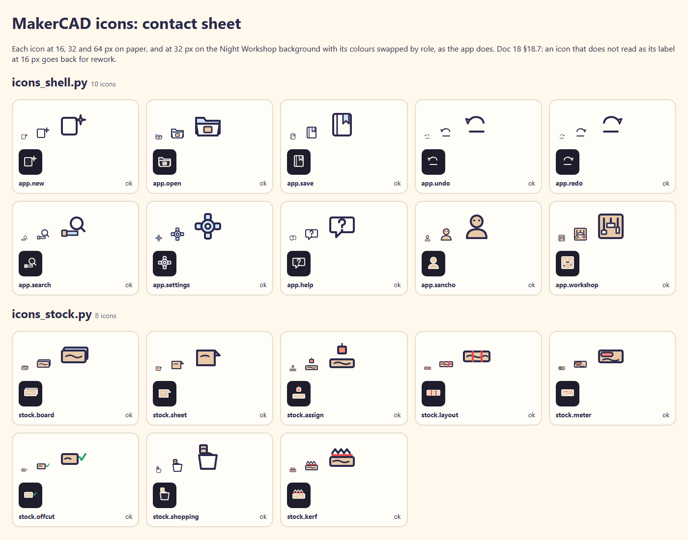
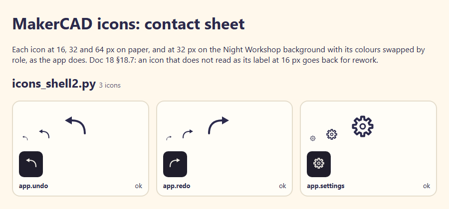

# Review: Crew campaign mk-icons-1 (the first icons)

Reviewed by Claude on 2026-11-19 on the contact sheet (doc 18 §18.7), before any icon landed.

## What happened

| Set | Member | Result | Requests |
|---|---|---|---|
| Shell (10) | Gordon | attempt 1 stopped as `loop_repeat` (a harness bug, below); attempt 2 accepted | 16 |
| Stock & Cut (8) | Deepak | accepted, first try | 2 |

Both sets pass every automatic rule (`tools/icon_lint.py`: palette only, round strokes of 3 or
4, at most one accent, inside the safe area, half-unit coordinates, 2–12 elements). Those are
the hidden tests; the look is judged by a person.

## The person's half: does each read at 16 px?

| Icon | Verdict |
|---|---|
| `app.new`, `app.open`, `app.save`, `app.search`, `app.help`, `app.sancho`, `app.workshop` | **landed** |
| `app.undo`, `app.redo` | **rework**: at 16 px they read as a small cup; the arrow heads are too small and the arc too flat |
| `app.settings` | **rework**: four teeth read as a crosshair or joystick, not a gear |
| all 8 Stock & Cut icons | **landed**. Deepak kept the family element (a board with a grain line) in every one, as doc 18 asks. `stock.shopping` is the weakest (more bucket than tote) but reads |

The rework is campaign **mk-icons-2** (`crew/contracts/mk_icons.md`, set `shell2`), with the
reasons and what to draw instead.

## A harness bug the campaign found

Gordon's first attempt wrote tool calls as flat JSON, `{"tool": "read_file", "path": "…"}`.
The harness read arguments only from an `"args"` key, so every call arrived with no arguments,
looked identical to the last, and the repeat guard ended the attempt. Fixed in
`crew/agent.py` (`_find_tool_json_at`: with no `"args"`, the other keys are the arguments), with
a regression test; the crew suite is 199 passed, the 2 failures that predate tonight unchanged.
This is the kind of failure that used to stop work with nobody noticing.

## The rework: mk-icons-2 (same night)

Gordon, with his first set as reference and the reasons above. Attempt 1 broke a rule (the
hidden tests said which); attempt 2 accepted, 14 requests. On the sheet: undo and redo are now
one bold curved arrow each with a big head, and settings is an eight-toothed gear. All three
read at 16 px and **landed**, so all 18 icons of mk-icons-1 are in the app.

## What landed

`apps/mk-desktop/assets/icons/<id>.svg` for the 15, each with a `.attribution` sidecar (AGENTS.md
rule 4), and `src/icon_data.rs` regenerated by `tools/icons_land.py`. The app rasterises them at
runtime and swaps ink, paper and tint for the Night Workshop look (`src/icons.rs`); the contact
sheet's dark row shows that swap. On the opening screen, `app.settings`, `app.help`, `app.new`,
`app.open` and `app.workshop` replace the painted stand-ins.
