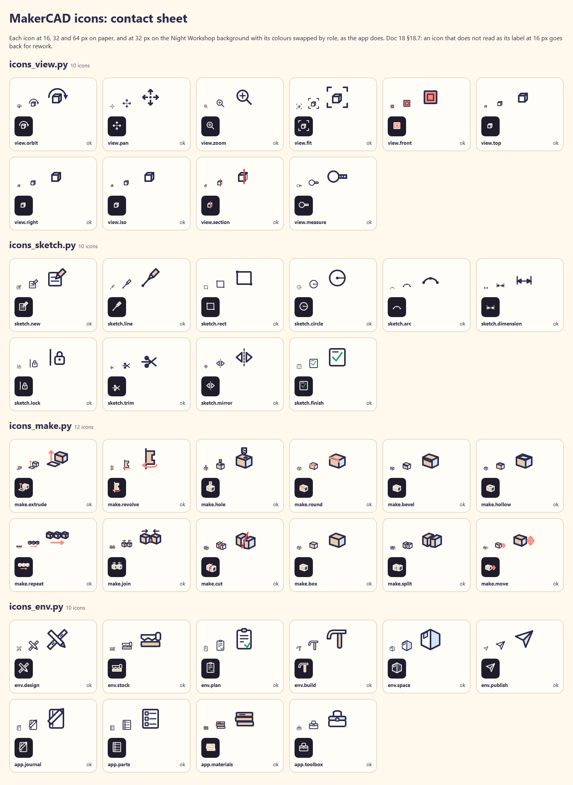

# Review: Crew campaign mk-icons-3 (42 icons for P1)

Reviewed by Claude on 2026-11-20 on the contact sheet (doc 18 §18.7), before any icon landed.

## What happened

The campaign ran on its own from the keeper (registered 07:02, finished 10:02).

| Set | Member | Result | Requests | Minutes |
|---|---|---|---|---|
| View (10) | Gordon | accepted on attempt 2 | 17 | 51.3 |
| Sketch (10) | Deepak | accepted, first try | 9 | 9.1 |
| Make (12) | Kimi | accepted, first try | 7 | 3.8 |
| Env (10) | Qwen | accepted, first try | 7 | 18.1 |

In all, 40 requests and 746,980 tokens. All four modules pass every automatic rule
(`python tools/icon_lint.py icons_view.py icons_sketch.py icons_make.py icons_env.py`: ok ×4).

## The person's half: does each read at 16 px?

| Icons | Verdict |
|---|---|
| all 10 Sketch icons | **landed**. The pencil family element is consistent, and each reads at 16 px |
| `view.orbit`, `view.pan`, `view.zoom`, `view.fit`, `view.front`, `view.section` | **landed** |
| `view.top`, `view.right`, `view.iso` | **rework**: at 16 px the three are the same small cube. The top face has no visible accent, and the right face's accent is only a thin line |
| `view.measure` | **rework**: reads as a key (a ring with a stub), not a tape measure |
| `make.extrude`, `make.revolve`, `make.hole`, `make.join`, `make.cut`, `make.box`, `make.split`, `make.move` | **landed** |
| `make.round`, `make.bevel`, `make.hollow` | **rework**: at 16 px all three look like `make.box`, because the change is under 6 grid units |
| `make.repeat` | **rework**: three tiny blocks read as dots |
| `env.design`, `env.plan`, `env.space`, `env.publish`, `app.journal`, `app.parts`, `app.materials`, `app.toolbox` | **landed** (`env.space` reads more as a box than a room corner, but works with its tab label) |
| `env.build` | **rework**: the hammer reads as the letter T |
| `env.stock` | **rework**: at 16 px a smudge |

So 32 landed and 10 went back. The rework is campaign **mk-icons-4**
(`crew/contracts/mk_icons.md`, set `fix3`), with Deepak writing and Kimi testing. Each row of
its table says what was wrong and what to draw. The common cause is scale: one grid unit is a
quarter of a pixel at 16 px, so these icons need the change drawn at least 6 units big.

## Note for the next icon contract

Say "draw it big" in the set's own table, not only in the general rules. Every icon that came
back had its distinguishing detail drawn at 64 px proportions.
