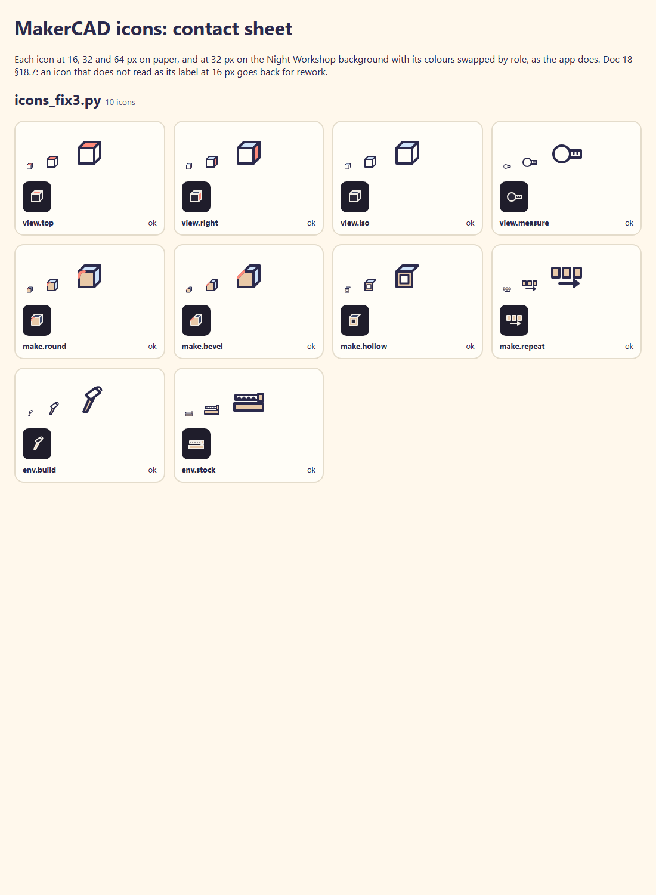

# Review: Crew campaign mk-icons-4 (rework of 10 icons)

Reviewed by Claude on 2026-11-21 on the contact sheet (doc 18 §18.7), before any icon landed.

## What happened

The keeper ran the campaign on 2026-11-20 at 13:21. Deepak wrote all ten on the first try: 4
requests, 67,446 tokens, 6.3 minutes. `python tools/icon_lint.py icons_fix3.py`: ok.

## The person's half: does each read at 16 px?

| Icons | Verdict |
|---|---|
| `view.top`, `view.right`, `view.iso` | **landed**. The cube is now big, and the coral face (top, right, none) tells them apart at 32 px; at 16 px it's still small, but different |
| `make.round`, `make.bevel` | **landed**. The coral edge sets them apart from `make.box`. Deepak rounded the front left edge, not the top right one the contract asked for; it reads either way |
| `make.repeat` | **landed**. Three solid blocks and an ink arrow, not the asked-for two blocks, a ghost and a coral arrow; it reads at 32 px |
| `env.build` | **landed**. A hammer at an angle with a claw; it reads as a tool next to its tab label |
| `env.stock` | **landed**. A saw over a board; it's busy at 16 px, but fine as a tab icon at 22 px with its label |
| `view.measure` | **rework again**: still a ring with a toothed stub, so it reads as a key. The contract's rounded square case and tape with a hook were not followed |
| `make.hollow` | **rework again**: the hollow is drawn on the front face (a box with a window), not an open-top tray seen from above |

So 8 landed (`python tools/icons_land.py icons_fix3.py --campaign mk-icons-4 --member Deepak
--only …`; the app now ships 58 icons) and 2 went back. Those two are set `fix4` of campaign
**mk-icons-5**, which this time gives the shapes as coordinates, since the words alone were not
followed twice. The same campaign adds the shell's new icons (sets `shell3` and `env2`).
