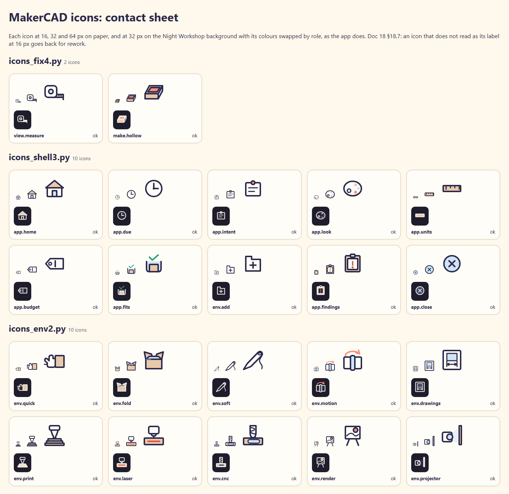

# Review: Crew campaign mk-icons-5 (the shell's icons, and two redraws)

Reviewed by Claude on 2026-11-21 on the contact sheet (doc 18 §18.7), before any icon landed.

## What happened

The keeper started the campaign on 2026-11-21 at 12:28, started it again at 13:52, and it
finished at 14:50. All three sets were accepted:
33 requests and 370,531 tokens for 22 icons.

| Set | Member | Icons | Attempts | Requests | What stopped the first attempt |
|---|---|---|---|---|---|
| `fix4` | Qwen | 2 | 2 | 14 | the hidden tests timed out at 180 s, most likely because a 14-minute build was running on the same PC; attempt 2 passed |
| `shell3` | Deepak | 10 | 2 | 13 | `empty_replies`: the reply budget went on thinking, not a judgement on the work |
| `env2` | Kimi | 10 | 1 | 6 | (first try) |

`python tools/icon_lint.py` on each set: ok.

## The person's half: does each read at 16 px?

| Icons | Verdict |
|---|---|
| `view.measure` | **landed**. Given as coordinates this time: a rounded case with a reel and a ruled tape with a hook. It reads as a tape measure, not a key |
| `make.hollow` | **landed**. An open-top tray seen from above with a coral inside, as asked |
| `app.home`, `app.look`, `app.units`, `app.intent` | **landed**. House, palette, ruler, note. These replace the lettered stand-ins in the project bar and status bar |
| `app.due`, `app.budget`, `app.fits`, `app.findings`, `app.close` | **landed**. Clock, price tag, box with a tick, clipboard with a warning, ringed cross. For the material meter and Stock & Cut; nothing uses them yet |
| `env.add` | **landed**. A folder with a plus. The "+ environment" menu does not use it yet |
| `env.fold`, `env.motion`, `env.drawings`, `env.print`, `env.laser`, `env.cnc`, `env.render`, `env.projector` | **landed**. Each reads beside its menu label; the machine three (print, laser, CNC) are told apart by the head and the coral line |
| `env.soft` | **landed**. A needle and thread. At 16 px it could pass for a pen, but it sits next to its label |
| `env.quick` | **landed**, the weakest: a hand holding a block. At 16 px it's a smudge; at the menu's size, with its label, it holds up. Candidate for a redraw if Kris's notes mention it |

So all 22 landed (`python tools/icons_land.py <set> --campaign mk-icons-5 --member <member>`), and the
app now ships 80 icons. Every icon id the shell's code asks for now exists, so no lettered stand-ins
remain.
